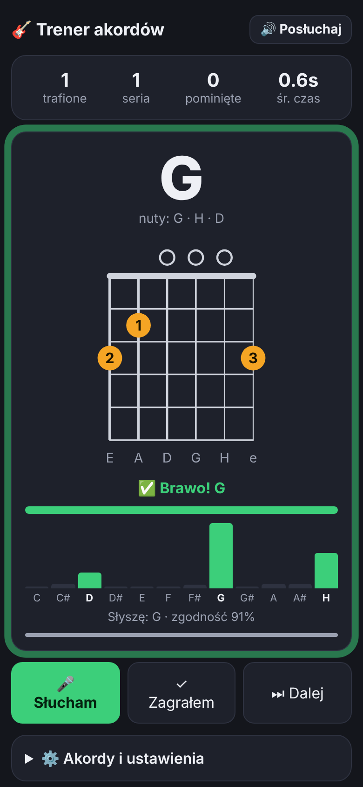

# 🎸 Trener akordów gitarowych

Aplikacja w jednym pliku (`index.html`), bez instalacji. Pokazuje akord z diagramem chwytu,
a Ty go grasz – mikrofon sprawdza, czy brzmi poprawnie.

## Uruchomienie
- **Komputer:** otwórz `index.html` w Chrome/Firefox/Edge (mikrofon działa z pliku lokalnego).
- **Telefon:** mikrofon w przeglądarce wymaga HTTPS – najprościej włączyć GitHub Pages
  (Settings → Pages → branch) i wejść na `https://<user>.github.io/<repo>/akordy/`.
  Lokalnie: `python3 -m http.server` i `http://localhost:8000/akordy/`.

## Funkcje
- 33 akordy: podstawowe, septymowe, sus/add9, barré (wybór zestawów w ustawieniach)
- diagram chwytu z numerami palców, nazwa w notacji polskiej (H, a, e…)
- 🔊 „Posłuchaj” – syntezowane brzmienie akordu
- rozpoznawanie z mikrofonu + podgląd 12 nut na żywo („Brakuje: F#”)
- tryb „ukryj chwyt” do nauki z pamięci, statystyki, czułość i czas trzymania
- bez mikrofonu: przycisk „Zagrałem”

## Jak działa rozpoznawanie
Nie szuka jednej nuty, tylko liczy **chromagram** – ile energii ma każda z 12 nut
(C, C#, D…) niezależnie od oktawy. Alikwoty niskich strun (które „udają” inne nuty)
są wyciszane. Wynik porównywany jest z wzorcem zadanego akordu oraz ze ~100 innymi
akordami, żeby odróżnić np. E od Em czy D od Dm. Akord trzeba utrzymać ~0,6 s.

Testowane na syntezowanych nagraniach (także z szumem, rozstrojeniem i słabym basem
jak w mikrofonie telefonu): 11/11 akordów rozpoznanych, bez mylenia E/Em, D/Dm, Am/Am7.
Ograniczenie: akordy o wspólnych nutach (np. Am7 i C) mogą się czasem pomylić.
